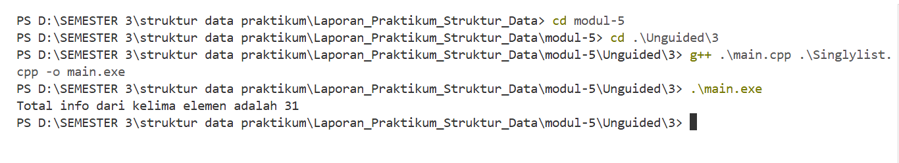

# Laporan Praktikum Modul 5 - Singly Linked List (Bagian Kedua)

Shasa Olivia Rose - 109082500207

## Dasar Teori

Singly linked list adalah linked list yang hanya punya satu arah pointer, jadi penelusurannya cuma bisa maju dari node pertama sampai node terakhir yang menunjuk ke Nil\[6\]. Karena bentuknya begitu, hampir semua operasi harus dimulai dengan berjalan dari `first`. Pada modul sebelumnya sudah dibahas pembuatan list, insert, delete, dan view. Di modul ini fokusnya pindah ke dua operasi lain, yaitu *searching* (pencarian) dan *update* (pengubahan data). Dua operasi ini penting karena pada aplikasi pengelolaan data yang isinya sering berubah, kita hampir selalu butuh menambah, menghapus, mencari, dan menampilkan data\[2\].

### A. Searching pada Singly Linked List

Searching adalah operasi mencari node tertentu dengan cara mengunjungi node satu per satu dan berhenti begitu node yang dicari ketemu\[6\]. Karena data di dalam list tidak harus terurut, pencarian yang dipakai adalah pencarian sekuensial\[5\].

#### 1. Pencarian berdasarkan data

Pointer bantu berjalan dari `first`, lalu isi tiap node dibandingkan dengan data yang dicari. Kalau cocok, posisi dan isi node ditampilkan, kalau sampai Nil belum ketemu berarti datanya tidak ada di list.

#### 2. Pencarian berdasarkan alamat dan range

Selain berdasarkan isi data, node juga bisa dicari lewat alamat memorinya, atau lewat rentang nilai tertentu (misalnya rentang harga). Pada pencarian range, penelusuran tidak berhenti di node pertama yang cocok karena bisa saja ada beberapa node yang masuk rentang.

#### 3. Peran searching bagi operasi lain

Menurut modul, hasil pencarian membuat operasi seperti *insert after*, *delete after*, dan *update* jadi lebih mudah\[6\]. Alasannya sederhana: operasi-operasi itu butuh alamat node acuan, dan alamat itu bisa didapat dari hasil pencarian.

### B. Update pada Singly Linked List

Update adalah operasi untuk mengubah data yang sudah tersimpan di dalam node. Prosesnya biasanya diawali dengan pencarian terhadap data yang akan diubah\[5\].

#### 1. Update pada node pertama

Node pertama langsung bisa diakses lewat `first`, jadi datanya tinggal ditimpa dengan nilai baru tanpa perlu menelusuri list.

#### 2. Update pada node terakhir dan node setelah node tertentu

Untuk node terakhir, pointer bantu harus berjalan dulu sampai node yang `next`-nya Nil. Untuk node setelah node tertentu, alamat node acuan (`Prev`) sudah diketahui, sehingga node yang diubah adalah `Prev->next`.

#### 3. Update hanya mengubah isi, bukan susunan

Berbeda dengan insert dan delete, update tidak mengubah sambungan pointer. Yang berubah cuma isi data di node, jadi jumlah dan urutan node di dalam list tetap sama.

## Guided

### 1. \[Header - listBuah.h\]

```C++
//Header guard digunakan untuk mencegah file header yang sama 
//di-include lebih dari sekali dalam satu program.
#ifndef LISTBUAH_H
#define LISTBUAH_H
#define Nil NULL

#include<iostream>
using namespace std;

struct buah{
    string nama;
    int jumlah; 
    float harga;
};

typedef buah dataBuah; //Memberikan nama alias databuah untuk struct buah.

typedef struct node *address; //Mendefinisikan alias address sebagai pointer ke struct node

struct node{ // node untuk isi dari linked listnya, isi setiap node adalah data & pointer next
    dataBuah isidata;
    address next;
};

struct linkedlist{ //ini linked list nya
    address first;
};

//semua function & prosedur yang akan dipakai
//Materi modul 4
bool isEmpty(linkedlist List);
void createList(linkedlist &List);
address alokasi(string nama, int jumlah, float harga);
void dealokasi(address &node);
void printList(linkedlist List);
void insertFirst(linkedlist &List, address nodeBaru);
void insertAfter(linkedlist &List, address nodeBaru, address Prev);
void insertLast(linkedlist &List, address nodeBaru);
void delFirst(linkedlist &List);
void delLast(linkedlist &List);
void delAfter(linkedlist &List, address nodeHapus, address nodePrev);
int nbList(linkedlist List);
void deleteList(linkedlist &List);

//materi modul 5 (update)
void updateFirst(linkedlist List);
void updateLast(linkedlist List);
void updateAfter(linkedlist List, address prev);

//materi modul 5 (searching)
void FindNodeByData(linkedlist list, string data);
void FindNodeByAddress(linkedlist list, address node);
void FindNodeByRange(linkedlist list, float hargaAwal, float HargaAkhir);

#endif
```

Strukturnya masih sama dengan header di modul 4, bedanya data yang disimpan sekarang berupa buah (nama, jumlah, harga) dan nama struct-nya `linkedlist`. Prototipe lama untuk insert, delete, print, dan hitung node tetap ada. Yang baru ada di bagian bawah, yaitu tiga prototipe update (`updateFirst`, `updateLast`, `updateAfter`) dan tiga prototipe searching (`FindNodeByData`, `FindNodeByAddress`, `FindNodeByRange`). Header guard di paling atas tetap dipakai biar file ini tidak ke-include dua kali.

### 2. \[Implementasi - listBuah.cpp\]

```C++
#include "listBuah.h"
#include <iostream>
using namespace std;

//fungsi untuk cek apakah list kosong atau tidak
bool isEmpty(linkedlist List) {
    if(List.first == Nil){
        return true; 
    } else {
        return false;
    }
}

//pembuatan linked list kosong
void createList(linkedlist &List) {
    List.first = Nil;
}

//pembuatan node baru dengan menerapkan manajemen memori
address alokasi(string nama, int jumlah, float harga) { 
    address nodeBaru = new node; 
    nodeBaru->isidata.nama = nama;
    nodeBaru->isidata.jumlah = jumlah; 
    nodeBaru->isidata.harga = harga;
    nodeBaru->next = Nil;
    return nodeBaru;
}

//penghapusan node dengan menerapkan manajemen memori
void dealokasi(address &node) {
    node->next = Nil;
    delete node;
}

//prosedur-prosedur untuk insert / menambahkan node baru kedalam list
void insertFirst(linkedlist &List, address nodeBaru) {
    nodeBaru->next = List.first; 
    List.first = nodeBaru;
}

void insertAfter(linkedlist &List, address nodeBaru, address Prev) {
    if (Prev != Nil) {
        nodeBaru->next = Prev->next;
        Prev->next = nodeBaru;
    } else {
        cout << "Node sebelumnya tidak valid!" << endl;
    }
}

void insertLast(linkedlist &List, address nodeBaru) {
    if (isEmpty(List)) {
        List.first = nodeBaru;
    } else {
        address nodeBantu = List.first;
        while (nodeBantu->next != Nil) {
            nodeBantu = nodeBantu->next;
        }
        nodeBantu->next = nodeBaru;
    }
}

//prosedur-prosedur untuk delete / menghapus node yang ada didalam list
void delFirst(linkedlist &List){
    address nodeHapus;
    if (isEmpty(List) == false) {
        nodeHapus = List.first;
        List.first = List.first->next;
        nodeHapus->next = Nil;
        dealokasi(nodeHapus);
        cout << "Node pertama berhasil terhapus!" << endl;
    } else {
        cout << "List kosong!" << endl;
    }
}

void delLast(linkedlist &List){
    address nodeHapus, nodePrev;
    if(isEmpty(List) == false){
        nodeHapus = List.first;
        if(nodeHapus->next == Nil){
            List.first->next = Nil;
            dealokasi(nodeHapus);
        } else { 
            while(nodeHapus->next != Nil){
                nodePrev = nodeHapus; 
                nodeHapus = nodeHapus->next;
            }
            nodePrev->next = Nil; 
            dealokasi(nodeHapus);
        }
        cout << "Node terakhir berhasil terhapus!" << endl;
    } else {
        cout << "list kosong" << endl;
    }
}

void delAfter(linkedlist &List, address nodeHapus, address nodePrev){
    if(isEmpty(List) == true){
        cout << "List kosong!" << endl;
    } else { //jika list tidak kosong
        if (nodePrev != Nil && nodePrev->next != Nil) { 
            nodeHapus = nodePrev->next;       
            nodePrev->next = nodeHapus->next;  
            nodeHapus->next = Nil;         
            dealokasi(nodeHapus);
            cout << "Node setelah node " << nodePrev->isidata.nama << " berhasil terhapus!" << endl;
        } else {
            cout << "Node sebelumnya (prev) tidak valid!" << endl;
        }
    }
}

//prosedur untuk menampilkan isi list
void printList(linkedlist List) {
    if (isEmpty(List)) {
        cout << "List kosong." << endl;
    } else {
        address nodeBantu = List.first;
        while (nodeBantu != Nil) { 
            cout << "Nama Buah : " << nodeBantu->isidata.nama << ", Jumlah : " << nodeBantu->isidata.jumlah << ", Harga : " << nodeBantu->isidata.harga << endl;
            nodeBantu = nodeBantu->next;
        }
    }
}

//function untuk menampilkan jumlah node didalam list
int nbList(linkedlist List) {
    int count = 0;
    address nodeBantu = List.first;
    while (nodeBantu != Nil) {
        count++;
        nodeBantu = nodeBantu->next; 
    }
    return count;
}

//prosedur untuk menghapus list (menghapus semua node didalam list)
void deleteList(linkedlist &List){
    address nodeBantu, nodeHapus;
    nodeBantu = List.first;
    while(nodeBantu != Nil){
        nodeHapus = nodeBantu;
        nodeBantu = nodeBantu->next;
        dealokasi(nodeHapus); 
    }
    List.first = Nil; 
    cout << "List berhasil terhapus!" << endl;
}

/*----- MATERI PERTEMUAN 5 - SINGLY LINKED LIST (BAGIAN KEDUA) - UPDATE -----*/
//prosedur-prosedur untuk melakukan update data node
void updateFirst(linkedlist List){
    if(isEmpty(List) == true){
        cout << "List kosong!" << endl;
    } else {
        cout << "Masukkan update data node pertama : " << endl;
        cout << "Nama buah : ";
        cin >> List.first->isidata.nama;
        cout << "Jumlah : ";
        cin >> List.first->isidata.jumlah;
        cout << "Harga : ";
        cin >> List.first->isidata.harga;
        cout << "Data Berhasil Diupdate!" << endl;
        cout << endl;
    }
}

void updateLast(linkedlist List){
    if (isEmpty(List) == true) {
        cout << "List Kosong!" << endl;
    } else {
        address nodeBantu = List.first;
        while (nodeBantu->next != Nil) {
            nodeBantu = nodeBantu->next;
        }
        cout << "masukkan update data node terakhir : " << endl;
        cout << "Nama buah : ";
        cin >> nodeBantu->isidata.nama;
        cout << "Jumlah : ";
        cin >> nodeBantu->isidata.jumlah;
        cout << "Harga : ";
        cin >> nodeBantu->isidata.harga;
        cout << "Data Berhasil Diupdate!" << endl;
        cout << endl;
    }
}

void updateAfter(linkedlist List, address nodePrev){
    if(isEmpty(List) == true){
        cout << "List kosong!" << endl;
    } else {
        if (nodePrev != Nil && nodePrev->next != Nil){
            address nodeBantu = nodePrev->next;
            cout << "masukkan update data node setelah node " << nodePrev->isidata.nama << " : " << endl;
            cout << "Nama buah : ";
            cin >> nodeBantu->isidata.nama;
            cout << "Jumlah : ";
            cin >> nodeBantu->isidata.jumlah;
            cout << "Harga : ";
            cin >> nodeBantu->isidata.harga;
            cout << "Data Berhasil Diupdate!" << endl;
            cout << endl;
        } else {
            cout << "Node sebelumnya (prev) tidak valid!" << endl;
        }
    }
}

/*----- MATERI PERTEMUAN 5 - SINGLY LINKED LIST (BAGIAN KEDUA) - SEARCHING -----*/
//prosedur-prosedur untuk searching data
//prosedur untuk mencari node berdasarkan data
void FindNodeByData(linkedlist list, string data){
    if(isEmpty(list) == true){
        cout << "List kosong!" << endl;
    } else {
        address nodeBantu = list.first;
        int posisi = 0;
        bool found = false;
        while(nodeBantu != Nil){
            posisi++;
            if(nodeBantu->isidata.nama == data){
                cout << "Data " << data << " ditemukan pada posisi ke-" << posisi << "!" << endl;
                cout << "Nama Buah : " << nodeBantu->isidata.nama << ", Jumlah : " << nodeBantu->isidata.jumlah << ", Harga : " << nodeBantu->isidata.harga << endl;
                found = true;
                break;
            }
            nodeBantu = nodeBantu->next;
        }
        if(found == false){
            cout << "Node dengan data " << data << " tidak ditemukan!" << endl;
        }
    }
    cout << endl;
}

//prosedur untuk mencari node berdasarkan alamat node
void FindNodeByAddress(linkedlist list, address node) {
    if(isEmpty(list) == true) {
        cout << "List kosong!" << endl;
    } else {
        address nodeBantu = list.first;
        int posisi = 0;
        bool found = false;
        while (nodeBantu != Nil) {
            posisi++;
            if(nodeBantu == node) {
                cout << "Node ditemukan pada posisi ke-" << posisi << "!" << endl;
                cout << "Alamat node : " << nodeBantu << endl;
                cout << "Nama Buah : " << nodeBantu->isidata.nama << ", Jumlah : " << nodeBantu->isidata.jumlah << ", Harga : " << nodeBantu->isidata.harga << endl;
                found = true;
                break;
            }
            nodeBantu = nodeBantu->next;
        }
        if(found == false) {
            cout << "Node dengan alamat " << node << " tidak ditemukan dalam list!" << endl;
        }
    }
    cout << endl;
}

//prosedur untuk mencari node berdasarkan range data (range harga)
void FindNodeByRange(linkedlist list, float hargaAwal, float hargaAkhir) {
    if(isEmpty(list) == true) {
        cout << "List kosong!" << endl;
    } else {
        address nodeBantu = list.first;
        int posisi = 0;
        bool found = false;
        cout << "--- Buah dalam range harga " << hargaAwal << " - " << hargaAkhir << " ---" << endl;
        cout << "-------------------------------------------" << endl;
        while (nodeBantu != Nil) {
            posisi++;
            float harga = nodeBantu->isidata.harga;
            if(harga >= hargaAwal && harga <= hargaAkhir) {
                cout << "Data ditemukan pada posisi ke-" << posisi << " :" << endl;
                cout << "Nama Buah : " << nodeBantu->isidata.nama << ", Jumlah : " << nodeBantu->isidata.jumlah << ", Harga : " << nodeBantu->isidata.harga << endl;
                cout << "-------------------------------------------" << endl;
                found = true;
            }
            nodeBantu = nodeBantu->next;
        }
        if(found == false) {
            cout << "Tidak ada data buah dalam range harga tersebut!" << endl;
            cout << "-------------------------------------------" << endl;
        }
    }
    cout << endl;
}
```

Bagian atas file ini (sampai `deleteList`) isinya fungsi-fungsi dari modul 4 yang cuma disesuaikan dengan data buah, dan `delFirst`, `delLast`, serta `delAfter` sekarang sekalian mencetak pesan kalau node berhasil dihapus.

Yang baru ada di dua blok terakhir. Di blok **update**, ketiga fungsinya sama-sama menerima `linkedlist` sebagai nilai (bukan referensi), tapi data tetap berubah permanen karena yang disalin cuma `first`-nya, sedangkan node-nodenya tetap node yang sama di memori. `updateFirst` langsung mengisi ulang data di `List.first`. `updateLast` berjalan dulu sampai node yang `next`-nya Nil, baru datanya diisi ulang. `updateAfter` mengubah node di `nodePrev->next`. Ketiganya membaca data baru lewat `cin`, jadi nama buah yang dimasukkan sebaiknya satu kata saja karena `cin >>` berhenti di spasi.

Di blok **searching**, `FindNodeByData` menelusuri list sambil menghitung posisi dan membandingkan nama buah, lalu berhenti (`break`) begitu ketemu. `FindNodeByAddress` caranya sama, tapi yang dibandingkan adalah alamat node, dan alamatnya ikut dicetak kalau ketemu. `FindNodeByRange` sedikit beda: karena bisa ada beberapa buah yang harganya masuk rentang, penelusurannya tidak pakai `break` dan terus berjalan sampai ujung list. Variabel `found` dipakai di ketiganya untuk menentukan perlu tidaknya mencetak pesan "tidak ditemukan".

### 3. \[Program Utama - main.cpp\]

```C++
#include "listBuah.h"

#include <iostream>
using namespace std;

int main()
{
    linkedlist List;
    address nodeA, nodeB, nodeC, nodeD, nodeE = Nil;
    createList(List);

    dataBuah dtBuah;

    nodeA = alokasi("Jeruk", 100, 3000);
    nodeB = alokasi("Apel", 75, 4000);
    nodeC = alokasi("Pir", 87, 5000);
    nodeD = alokasi("Semangka", 43, 11500);
    nodeE = alokasi("Durian", 15, 31450);

    insertFirst(List, nodeA);
    insertLast(List, nodeB);
    insertAfter(List, nodeC, nodeA);
    insertAfter(List, nodeD, nodeC);
    insertLast(List, nodeE);

    cout << "--- ISI LIST SETELAH DILAKUKAN INSERT ---" << endl;
    printList(List);
    cout << "jumlah node : " << nbList(List) << endl;
    cout << endl;

    updateFirst(List);
    printList(List);
    updateLast(List);
    printList(List);
    updateAfter(List, nodeD);
    printList(List);

    cout << "--- ISI LIST SETELAH DILAKUKAN UPDATE ---" << endl;
    printList(List);
    cout << "jumlah node : " << nbList(List) << endl;
    cout << endl;

    FindNodeByData(List, "kelapa");
    FindNodeByAddress(List, nodeC);
    FindNodeByRange(List, 5000, 10000);

    delFirst(List);
    printList(List);
    delLast(List);
    printList(List);
    delAfter(List, nodeD, nodeC);
    printList(List);

    cout << "--- ISI LIST SETELAH DILAKUKAN DELETE ---" << endl;
    printList(List);
    cout << "jumlah node : " << nbList(List) << endl;
    cout << endl;

    deleteList(List);
    cout << "--- ISI LIST SETELAH DILAKUKAN HAPUS LIST ---" << endl;
    printList(List);
    cout << "jumlah node : " << nbList(List) << endl;
    cout << endl;

    return 0;
}
```

Awalnya lima node buah dimasukkan dengan cara yang sama seperti modul 4, sehingga urutan list-nya Jeruk → Pir → Semangka → Apel → Durian (5 node). Setelah itu program minta input tiga kali lewat `updateFirst` (mengubah Jeruk), `updateLast` (mengubah Durian), dan `updateAfter(List, nodeD)` (mengubah node setelah Semangka, yaitu Apel). Jumlah node tetap 5 karena update cuma mengganti isi.

Lalu masuk ke searching. Pencarian "kelapa" pasti gagal karena tidak ada di list. `FindNodeByAddress(List, nodeC)` menemukan Pir di posisi ke-2, dan `FindNodeByRange(List, 5000, 10000)` menampilkan buah yang harganya masuk 5000 sampai 10000 (hasilnya bergantung pada harga yang kamu masukkan saat update, karena Pir sendiri tidak diubah dan harganya tepat 5000).

Terakhir, bagian delete: `delFirst` membuang node pertama, `delLast` membuang node terakhir, dan `delAfter(List, nodeD, nodeC)` membuang node setelah Pir, yaitu Semangka. Sisanya tinggal dua node (Pir dan Apel), lalu `deleteList` mengosongkan semuanya sehingga `printList` menampilkan "List kosong." dan jumlah node 0.

## Unguided

### 1. Membuat ADT Singly Linked List (`Singlylist.h`, `Singlylist.cpp`, `main.cpp`) lalu menampilkan isi list 9 12 8 0 2 dengan `insertFirst`

**\[Header - Singlylist.h\]**

```C++
#ifndef SINGLYLIST_H
#define SINGLYLIST_H
#define Nil nullptr

#include <iostream>
using namespace std;

typedef int infotype;
typedef struct ElmList *address;

struct ElmList {
    infotype info;
    address next;
};

struct List {
    address First;
};

void createList(List &L);
address alokasi(infotype x);
void dealokasi(address &P);
void printInfo(List L);
void insertFirst(List &L, address P);

#endif
```

**\[Implementasi - Singlylist.cpp\]**

```C++
#include "Singlylist.h"
#include <iostream>
using namespace std;

void createList(List &L) {
    L.First = Nil;
}

address alokasi(infotype x) {
    address P = new ElmList;
    if (P != Nil) {
        P->info = x;
        P->next = Nil;
    }
    return P;
}

void dealokasi(address &P) {
    delete P;
    P = Nil;
}

void insertFirst(List &L, address P) {
    P->next = L.First;
    L.First = P;
}

void printInfo(List L) {
    address P = L.First;
    while (P != Nil) {
        cout << P->info << " ";
        P = P->next;
    }
    cout << endl;
}
```

**\[Program Utama - main.cpp\]**

```C++
#include "Singlylist.h"
#include <iostream>
using namespace std;

int main() {
    List L;
    address P1, P2, P3, P4, P5 = Nil;
    createList(L);

    P1 = alokasi(2);
    insertFirst(L, P1);

    P2 = alokasi(0);
    insertFirst(L, P2);

    P3 = alokasi(8);
    insertFirst(L, P3);

    P4 = alokasi(12);
    insertFirst(L, P4);

    P5 = alokasi(9);
    insertFirst(L, P5);

    printInfo(L);
    return 0;
}
```

### Output Unguided 1 :

##### Output 1


Soal pertama ini fondasi buat dua soal berikutnya, jadi ADT-nya dibuat dulu dengan tipe data `int`. `createList` mengosongkan list, `alokasi` membuat node baru (dan mengecek dulu `new`-nya berhasil), `dealokasi` membuang node sekaligus mengembalikan pointernya ke Nil, dan `printInfo` mencetak isi node dari `First` sampai ujung, dipisah spasi.

Karena semua node dimasukkan pakai `insertFirst`, node yang masuk terakhir justru jadi yang paling depan. Nilai 2, 0, 8, 12, 9 dimasukkan berurutan, sehingga list terbaca 9 → 12 → 8 → 0 → 2 dan outputnya `9 12 8 0 2` sesuai yang diminta soal. Di `main`, titik koma setelah `printInfo(L)` saya tambahkan karena di soal aslinya tidak ada.

### 2. Mencari elemen dengan info 8 dengan membuat fungsi baru `findElm(L : List, x : infotype) : address`

**\[Header - Singlylist.h\]**

```C++
#ifndef SINGLYLIST_H
#define SINGLYLIST_H
#define Nil nullptr

#include <iostream>
using namespace std;

typedef int infotype;
typedef struct ElmList *address;

struct ElmList {
    infotype info;
    address next;
};

struct List {
    address First;
};

void createList(List &L);
address alokasi(infotype x);
void dealokasi(address &P);
void printInfo(List L);
void insertFirst(List &L, address P);

address findElm(List L, infotype x);

#endif
```

**\[Implementasi - Singlylist.cpp\]**

```C++
#include "Singlylist.h"
#include <iostream>
using namespace std;

void createList(List &L) {
    L.First = Nil;
}

address alokasi(infotype x) {
    address P = new ElmList;
    if (P != Nil) {
        P->info = x;
        P->next = Nil;
    }
    return P;
}

void dealokasi(address &P) {
    delete P;
    P = Nil;
}

void insertFirst(List &L, address P) {
    P->next = L.First;
    L.First = P;
}

void printInfo(List L) {
    address P = L.First;
    while (P != Nil) {
        cout << P->info << " ";
        P = P->next;
    }
    cout << endl;
}

address findElm(List L, infotype x) {
    address P = L.First;
    while (P != Nil) {
        if (P->info == x) {
            return P;
        }
        P = P->next;
    }
    return Nil;
}
```

**\[Program Utama - main.cpp\]**

```C++
#include "Singlylist.h"
#include <iostream>
using namespace std;

int main() {
    List L;
    address P1, P2, P3, P4, P5 = Nil;
    createList(L);

    P1 = alokasi(2);
    insertFirst(L, P1);

    P2 = alokasi(0);
    insertFirst(L, P2);

    P3 = alokasi(8);
    insertFirst(L, P3);

    P4 = alokasi(12);
    insertFirst(L, P4);

    P5 = alokasi(9);
    insertFirst(L, P5);

    address hasil = findElm(L, 8);
    if (hasil != Nil) {
        cout << hasil->info << " ditemukan dalam list" << endl;
    } else {
        cout << "8 tidak ditemukan dalam list" << endl;
    }

    return 0;
}
```

### Output Unguided 2 :

##### Output 1


Soal kedua menambahkan satu fungsi baru, `findElm`, yang mengembalikan alamat node pertama yang `info`-nya sama dengan `x`. Cara kerjanya mirip pencarian di Guided: pointer `P` mulai dari `First`, lalu di tiap node dicek apakah `P->info == x`. Kalau cocok, alamat `P` langsung dikembalikan. Kalau `P` sudah mencapai Nil tanpa ketemu, fungsi mengembalikan Nil.

Di `main`, hasil `findElm(L, 8)` ditampung di `hasil`. Karena 8 memang ada di list (9 → 12 → 8 → 0 → 2), `hasil` tidak Nil dan yang tercetak adalah `8 ditemukan dalam list`. Bagian `else` tetap saya sediakan untuk kasus angka yang dicari tidak ada. Header dan implementasi lain tidak berubah dari soal 1, hanya ditambah prototipe dan isi `findElm`.

### 3. Menghitung jumlah total info seluruh elemen (9+12+8+0+2=31)

**\[Header - Singlylist.h\]**

```C++
#ifndef SINGLYLIST_H
#define SINGLYLIST_H
#define Nil nullptr

#include <iostream>
using namespace std;

typedef int infotype;
typedef struct ElmList *address;

struct ElmList {
    infotype info;
    address next;
};

struct List {
    address First;
};

void createList(List &L);
address alokasi(infotype x);
void dealokasi(address &P);
void printInfo(List L);
void insertFirst(List &L, address P);

address findElm(List L, infotype x);
int totalInfo(List L);

#endif
```

**\[Implementasi - Singlylist.cpp\]**

```C++
#include "Singlylist.h"
#include <iostream>
using namespace std;

void createList(List &L) {
    L.First = Nil;
}

address alokasi(infotype x) {
    address P = new ElmList;
    if (P != Nil) {
        P->info = x;
        P->next = Nil;
    }
    return P;
}

void dealokasi(address &P) {
    delete P;
    P = Nil;
}

void insertFirst(List &L, address P) {
    P->next = L.First;
    L.First = P;
}

void printInfo(List L) {
    address P = L.First;
    while (P != Nil) {
        cout << P->info << " ";
        P = P->next;
    }
    cout << endl;
}

address findElm(List L, infotype x) {
    address P = L.First;
    while (P != Nil) {
        if (P->info == x) {
            return P;
        }
        P = P->next;
    }
    return Nil;
}

int totalInfo(List L) {
    int total = 0;
    address P = L.First;
    while (P != Nil) {
        total = total + P->info;
        P = P->next;
    }
    return total;
}
```

**\[Program Utama - main.cpp\]**

```C++
#include "Singlylist.h"
#include <iostream>
using namespace std;

int main() {
    List L;
    address P1, P2, P3, P4, P5 = Nil;
    createList(L);

    P1 = alokasi(2);
    insertFirst(L, P1);

    P2 = alokasi(0);
    insertFirst(L, P2);

    P3 = alokasi(8);
    insertFirst(L, P3);

    P4 = alokasi(12);
    insertFirst(L, P4);

    P5 = alokasi(9);
    insertFirst(L, P5);

    cout << "Total info dari kelima elemen adalah " << totalInfo(L) << endl;

    return 0;
}
```

### Output Unguided 3 :

##### Output 1



Soal ketiga meminta total dari semua nilai `info` di dalam list. Fungsi `totalInfo` dibuat dengan pola penelusuran yang sama seperti `nbList` di modul 4, bedanya bukan menghitung jumlah node (`count++`) tapi menambahkan nilai tiap node ke variabel `total`. Pointer `P` mulai dari `First`, nilainya ditambahkan ke `total`, lalu `P` pindah ke node berikutnya sampai ketemu Nil.

Untuk list 9 → 12 → 8 → 0 → 2, hasilnya 9 + 12 + 8 + 0 + 2 = 31, dan yang tercetak adalah `Total info dari kelima elemen adalah 31` seperti di modul. Pada kode ini `printInfo` dan `findElm` tidak dipanggil di `main` supaya output-nya sama persis dengan contoh di soal, tapi fungsinya tetap ada di file implementasi.

## Kesimpulan

Lewat modul ini saya jadi paham bahwa searching di singly linked list pada dasarnya cuma menelusuri node satu per satu dari `first` sampai ketemu atau sampai Nil. Hasil pencariannya bisa berupa posisi, alamat, atau malah beberapa node sekaligus kalau yang dicari adalah rentang nilai seperti pada `FindNodeByRange`. Operasi update ternyata lebih sederhana dari insert dan delete karena tidak mengubah sambungan pointer, cuma isi data di node, dan data itu tetap berubah walaupun list dikirim ke fungsi sebagai nilai karena node-nodenya tidak ikut disalin. Di bagian Unguided, pola penelusuran yang sama bisa dipakai ulang untuk `findElm` dan `totalInfo`, jadi setelah paham pola dasarnya, fungsi baru tinggal menyesuaikan apa yang dilakukan di tiap node.

## Referensi

\[1\] Triase. (2020). Diktat Edisi Revisi : STRUKTUR DATA. Medan: UNIVERSTAS ISLAM NEGERI SUMATERA UTARA MEDAN. \
\[2\] Mbejo, M. T., Nopa, L. A., Putri, J. S., & Risky, M. (2025). "Analisis Struktur Data Linked List Dalam Pengolahan Data Mahasiswa". Jurnal Sains Informatika Terapan, 4(2), 441-444. Diakses pada 13 Oktober 2026 melalui [https://doi.org/10.62357/jsit.v4i2.591](https://doi.org/10.62357/jsit.v4i2.591). \
\[3\] Selamet, R. (2016). "Implementasi Struktur Data List, Queue dan Stack dalam Java". Media Informatika, 15(3). Diakses pada 13 Oktober 2026 melalui [https://jurnal.likmi.ac.id/Jurnal/11_2016/112016_03_Rachmat.pdf](https://jurnal.likmi.ac.id/Jurnal/11_2016/112016_03_Rachmat.pdf). \
\[4\] Indahyati, Uce., Rahmawati Yunianita. (2020). "BUKU AJAR ALGORITMA DAN PEMROGRAMAN DALAM BAHASA C++". Sidoarjo: Umsida Press. Diakses pada 10 Maret 2024 melalui [https://doi.org/10.21070/2020/978-623-6833-67-4](https://doi.org/10.21070/2020/978-623-6833-67-4). \
\[5\] Informatics Lab, Fakultas Informatika, Telkom University. (n.d.). Modul 4 Struktur Data: Singly Linked List (Bagian Pertama). Modul praktikum Struktur Data. \
\[6\] Informatics Lab, Fakultas Informatika, Telkom University. (n.d.). Modul 5 Struktur Data: Singly Linked List (Bagian Kedua). Modul praktikum Struktur Data.
